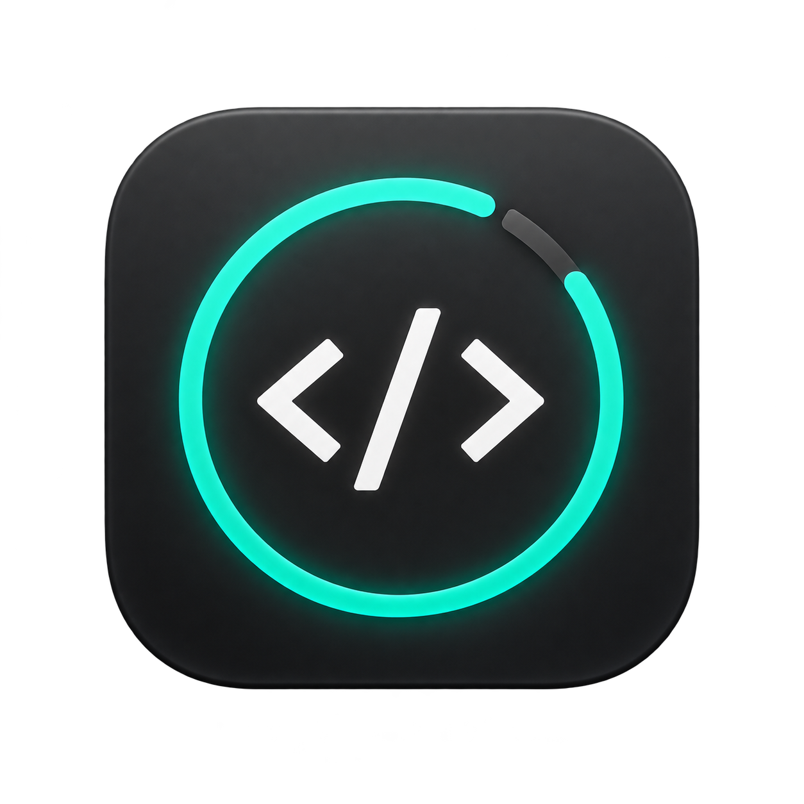
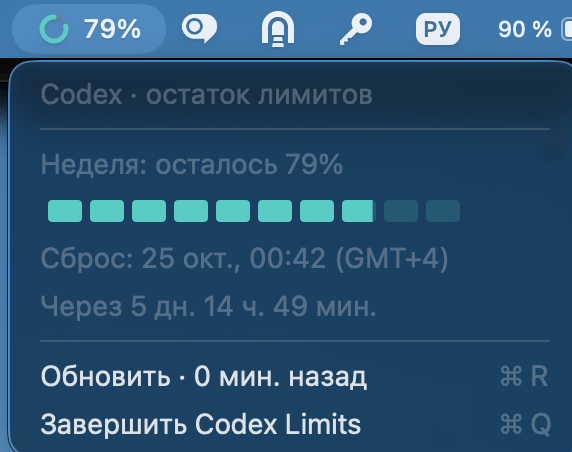

<p align="center"></p>

# Codex Limits

A small macOS menu bar app for viewing your remaining Codex quota and reset times.

**[Download the latest release](https://github.com/Kolin163/codex-limits/releases/latest)** · [Русская инструкция](#по-русски)

<p align="center"></p>

## Install

1. Download **Codex-Limits-macOS-arm64.zip** from Releases (not the automatic “Source code” archives).
2. Unzip and move **Codex Limits.app** to Applications.
3. Install Codex Desktop and sign in to your ChatGPT account if you have not already.
4. Open Codex Limits. Your remaining quota appears in the menu bar.

**Requirements:** Apple Silicon (M1 or later), macOS 13+, Codex Desktop in `/Applications` or `~/Applications`. Supported app names: `Codex.app` and `ChatGPT.app`. Intel Macs are not supported by this build.

The app uses the Codex executable included in supported Desktop installations and its available saved sign-in. No separate CLI installation or widget-specific login is required for these layouts. A standalone Codex CLI is supported as a fallback. Different profiles or credential stores can require a separate login. Desktop internal paths may change across releases.

This is an **independent community project**, not an official OpenAI app.

### macOS security prompt

The app is ad-hoc signed and **not notarized by Apple**. macOS may block the first launch. Review [Apple's instructions](https://support.apple.com/102445) and only proceed if you trust this source. Do not disable Gatekeeper globally.

## Features

- Remaining quota percentage and colored ring in the menu bar.
- All returned quota windows, colored bars, reset dates, and countdown on click.
- Teal: more than 60%; yellow: 25–60%; red: below 25%.
- The menu bar shows the smallest remaining percentage when multiple windows exist.
- Dates follow the system time zone, including changes while running.
- Refresh every three minutes, after wake, and on menu opening when data is older than a minute.
- Manual refresh with the age of the last successful update.

For automatic startup, add the app in **System Settings → General → Login Items**. Once sign-in is saved, the Desktop window does not need to remain open.

## Privacy and resource use

No analytics, ads, or application-owned telemetry. The app invokes the locally installed Codex app-server and only requests quota data through `account/rateLimits/read`. Codex handles authentication and network requests using its own configuration. This project does not bundle your credentials or read token files directly.

Queries run off the main thread, cannot overlap, have a 25-second deadline and a bounded response buffer. The temporary helper process is terminated and reaped after each query. Failed requests show a warning and retain the last successful data. No inference turns are started.

## Build from source

Requires macOS and Apple Command Line Tools (`xcode-select --install`).

```sh
git clone https://github.com/Kolin163/codex-limits.git
cd codex-limits
./scripts/build.sh
open 'build/Codex Limits.app'
```

The script builds an optimized Apple Silicon binary, packages its icon and Info.plist, adds an ad-hoc signature, runs color-threshold checks, and creates an application ZIP and SHA-256 checksum in `build/`.

Optional live integration check (uses your local Codex sign-in):

```sh
'build/Codex Limits.app/Contents/MacOS/CodexLimits' --desktop-check
```

## Releases

Pushing a `v*` tag, or updating the version in `Resources/Info.plist` on `main`, runs the macOS build workflow and publishes the ZIP and checksum to GitHub Releases. Existing releases are left unchanged. The workflow needs GitHub Actions enabled and uses the repository-scoped `GITHUB_TOKEN`; no personal token or signing certificate is included. Manual workflow runs build and validate without publishing.

## По-русски

Скачайте **Codex-Limits-macOS-arm64.zip** в [Releases](https://github.com/Kolin163/codex-limits/releases/latest), распакуйте и перенесите приложение в «Программы». Нужен Mac с M1 или новее, macOS 13+ и установленный Codex Desktop с выполненным входом. Отдельно ставить CLI не требуется для поддерживаемых версий Desktop.

В панели показывается остаток лимита; по нажатию — подробности и время сброса. Бирюзовый — больше 60%, жёлтый — 25–60%, красный — ниже 25%. Время берётся из настроек macOS. Автообновление — раз в три минуты; рядом с кнопкой «Обновить» указана давность последнего успешного обновления.

Для автозапуска добавьте приложение в «Системные настройки → Основные → Объекты входа». Сохранённый вход позволяет пользоваться виджетом без открытого окна Codex. При разных профилях аккаунт может отличаться; внутреннее устройство Desktop может измениться после обновления.

Приложение пока без нотариализации Apple, поэтому возможно предупреждение при первом запуске — [инструкция Apple](https://support.apple.com/102445).

## License

[MIT](LICENSE). The app icon was generated with AI. OpenAI and Codex names belong to their respective owners; no affiliation or endorsement is implied.
